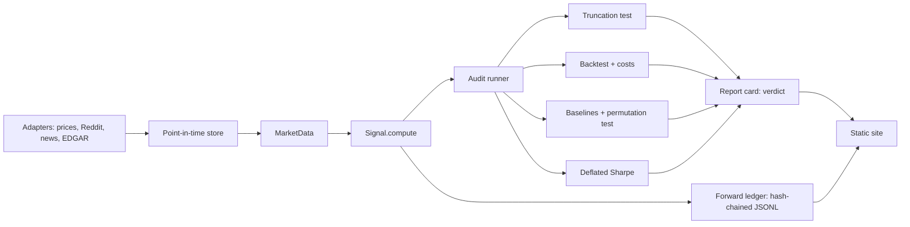

# Signal Audit Lab — Build Spec

Technical companion to [PRD.md](PRD.md). The PRD says what and why; this says how.

## 1. Architecture



Everything runs as a library plus a CLI. There is no server in v1: scheduled
GitHub Actions jobs run the pipeline and commit outputs, and a static site
reads them. This keeps hosting at $0.

## 2. Repository layout

```
src/signal_audit/
  config.py            settings from environment
  sessions.py          NYSE calendar: sessions, holidays, early closes
  data/
    pit.py             PointInTimeStore
    market.py          MarketData (prices + documents + engagement) and truncate()
    synthetic.py       seeded synthetic data for demos and tests
    adapters/
      prices.py        yfinance loader
      reddit.py        official Reddit API client
    sanity.py          price sanity checks run before real-data audits
    universe.py        universe file parser
  signals/
    base.py            Signal protocol
    examples.py        honest reference signals
    planted.py         deliberately leaky signals for the leak suite
  audit/
    backtest.py        close-T decision, open-T+1 execution, costs
    metrics.py         Sharpe, drawdown, PSR, deflated Sharpe
    baselines.py       buy-and-hold, permutation test
    leakage.py         truncation test
    report.py          AuditReport and verdict
    runner.py          audit_signal(), leak suite
  ledger/
    ledger.py          append-only hash-chained ledger
    outcomes.py        realised outcomes, in their own hash chain
  cli.py               sigaudit entry point
tests/                 one test module per source module
docs/                  PRD.md, SPEC.md
data/labels/           small labelled sets (tracked)
data/cache/            downloaded data (ignored)
universes/             ticker universe files (tracked)
reports/               committed report cards (Markdown and JSON)
records/               forward ledger and outcomes, committed by the daily job
legacy/                the previous trading-bot project, frozen
```

## 3. Core concepts

### 3.1 Two timestamps on every record
- `event_time`: when the thing happened (post created, article published).
- `knowledge_time`: when this system could first have known it.

For live collection, `knowledge_time` is the fetch time. For archives it is
`event_time` plus a declared lag, and any result built on archives states that
assumption. `knowledge_time >= event_time` is enforced. Both are tz-aware UTC.

All "as of" queries filter on `knowledge_time`. Filtering on `event_time` is the
most common real-world leak and is one of the planted leaks.

### 3.2 Decision and execution convention
- A score for date T may use anything known by the **close of T**
  (16:00 America/New_York).
- Orders execute at the **open of T+1**.
- The position earns the open-to-open return from T+1 to T+2.
- Costs are `turnover × bps / 10_000`, charged when weights change.

This is fixed in `audit/backtest.py`. Signals never choose their own fill price.

Sessions, holidays (with their weekend-observance rules), special closures and
13:00 early closes come from the NYSE (`XNYS`) calendar of the free
`exchange_calendars` package, wrapped in `sessions.py`. "Close of T" is the
true close, so a document seen at 14:00 New York on the day after Thanksgiving
counts toward the next session. Synthetic data uses every weekday; a weekday
that is not an NYSE session keeps regular 09:30 and 16:00 times.

### 3.3 Signal interface

```python
class Signal(Protocol):
    name: str

    def compute(self, data: MarketData) -> pd.DataFrame: ...
```

`compute` returns a frame indexed by date with one column per ticker. Higher
score means more bullish; NaN means no opinion. An honest signal's row for date
T depends only on data known by the close of T.

### 3.4 Truncation test (the core leak check)
1. Compute scores on the full dataset → `S_full`.
2. Pick cut dates. For each cut `c`, build `data.truncate(c)` (prices up to `c`,
   documents and engagement snapshots with `knowledge_time` ≤ close of `c`) and
   compute → `S_c`.
3. Compare `S_full` and `S_c` on all dates ≤ `c`. Any difference beyond
   tolerance is a leak: the past changed when the future was removed.

This catches full-sample normalisation, centred windows, negative shifts,
back-filling, event-time bucketing and archived engagement. Engagement leaks
(a post's score or comment count read at a later value than was visible at the
decision) are caught only when engagement is stored as snapshots, each with its
own `knowledge_time`. It does **not** catch a model that memorised the future
(handled by the model-cutoff check, P1) or a universe chosen with hindsight
(survivorship, P2). The report card lists which checks ran.

### 3.5 Statistics
- **Permutation test:** shuffle the date order of the score matrix, re-run the
  backtest, repeat N times. p-value = (1 + count(null Sharpe ≥ observed)) / (N + 1).
- **Deflated Sharpe ratio** (Bailey & López de Prado, 2014): probability the
  true Sharpe exceeds zero given sample length, skew, kurtosis and the number of
  variants tried. `n_trials` must be reported honestly by the user; the report
  card prints it.
- **Cost sensitivity:** Sharpe at 0, 10 and 25 bps.

### 3.6 Verdict rules

| Verdict | Rule |
|---|---|
| `LEAK_DETECTED` | Truncation test failed. Performance numbers are void. |
| `EDGE_SURVIVES` | No leak, permutation p ≤ 0.05, deflated Sharpe ≥ 0.95, and Sharpe at 25 bps > 0 |
| `NO_EDGE` | No leak, and permutation p > 0.20 or Sharpe at 10 bps ≤ 0 |
| `INCONCLUSIVE` | Anything else |

Thresholds live in one place (`audit/report.py`) and are printed on every report.

### 3.7 Forward ledger
- JSONL, one entry per line: `seq`, `made_at`, `signal`, `as_of`, `scores`,
  `universe`, `top_k`, `prev_hash`, `hash`.
- `hash` = SHA-256 of the canonical JSON of the entry without `hash`.
  `universe` and `top_k` were added later and are hashed only when set, so an
  entry in the original format keeps its hash.
- `as_of` must be an NYSE session. An entry is on time only if `made_at` is
  before the open of the session after `as_of`. Late entries are rejected.
- `sigaudit ledger record` uses the latest completed session as `as_of`. It is
  idempotent per (signal, universe, `as_of`), and records nothing if the
  price data does not yet contain that session.
- The file is committed to git by the scheduled job, so commit history is an
  independent timestamp.
- Outcomes are written to a separate file; predictions are never edited.
  `sigaudit ledger score` appends one outcome per entry once its holding
  period is over: bought at the open of the session after `as_of`, sold at the
  next session's open. Each outcome stores `seq`, `made_at`, `entry_seq`,
  `entry_hash`, `signal`, `universe`, `as_of`, `top_k`, `entered`,
  `exited`, `weights`, `ticker_returns`, `gross_return`, `turnover`,
  `cost_bps` (10), `net_return`, `price_source`, `prev_hash` and `hash`.
  Returns come from `audit/backtest.py`; turnover is measured from the previous
  session's ledger weights for the same signal, as in the backtest.
- `sigaudit ledger verify` checks both chains, that every outcome names an
  existing entry by `seq` and `hash`, that no entry is scored twice, and that
  no outcome was written before its holding period ended.

## 4. Milestone acceptance criteria

### M0 — Scaffold (done)
- `make check` passes: lint, types, tests.
- `sigaudit demo` prints report cards for an honest, a random and a leaky signal.
- `sigaudit leak-suite` flags every planted leak and no honest signal.
- CI workflow present.

### M1 — Real prices (done; target: `make report-momentum`)
- `sigaudit audit --signal momentum --universe <file> --start --end` on real data.
- Price sanity checks: no negative prices, gaps reported, split adjustment confirmed.
- Report card for momentum committed under `reports/`, generated by a `make` target.

### M2 — Reddit data
- Reddit credentials obtained through the official application.
- Collector job writes ticker-tagged posts with both timestamps.
- Mention-spike signal audited; report card committed.
- Ticker extraction evaluated on a labelled sample (precision and recall reported).

### M3 — Forward ledger live (done for price-only signals; targets: `make ledger-record`, `make ledger-score`, `make ledger-verify`)
- `sigaudit ledger record` and `sigaudit ledger score` commands.
- Scheduled workflow (`.github/workflows/ledger.yml`) commits one entry per
  trading day per signal (`momentum` and `random` on the sector ETFs) to
  `records/`.
- Trading-holiday calendar in place (NYSE calendar, including early closes).

### M4 — Public site
- Static site built from `reports/` and the ledger; deployed on a free host.
- Shows leaderboard, per-signal report card, and ledger with verification status.

### M5 — Sentiment signals
- FinBERT signal; LLM signal behind a pluggable backend.
- Eval harness: accuracy, macro-F1, latency, cost per 1k documents, with real
  API calls only. A missing key skips the model; it never falls back to a mock.
- Model-cutoff check wired into the report card.

### M6 — Launch
- README generated from report cards.
- Replication of one published result documented.
- Posted to target communities.

## 5. Tooling

| Concern | Choice |
|---|---|
| Python | 3.11+ |
| Env and deps | uv, with a committed lockfile |
| Lint and format | ruff |
| Types | mypy (strict on `src/`) |
| Tests | pytest |
| CLI | typer |
| Config | pydantic-settings, `SIGAUDIT_` prefix |
| CI | GitHub Actions |

## 6. Known limitations of the scaffold

- One real-price report exists, for a price-only signal (momentum). No
  text-based signal has been audited on real data yet.
- Long-only top-k portfolio only.
- The forward ledger records price-only signals only. If yfinance has not
  published a session's bar when the daily job runs, that session is skipped
  and stays missing from the record; it cannot be added later.
- Reddit client is tested against a mocked transport, not the live API.
- No survivorship or model-memory checks yet.
- Engagement taken from an archive that stores one final value per post, stamped
  with the posting time, cannot be detected by the truncation test: removing
  the future removes nothing. Engagement must be collected as timestamped
  snapshots for the leak check to cover it.
