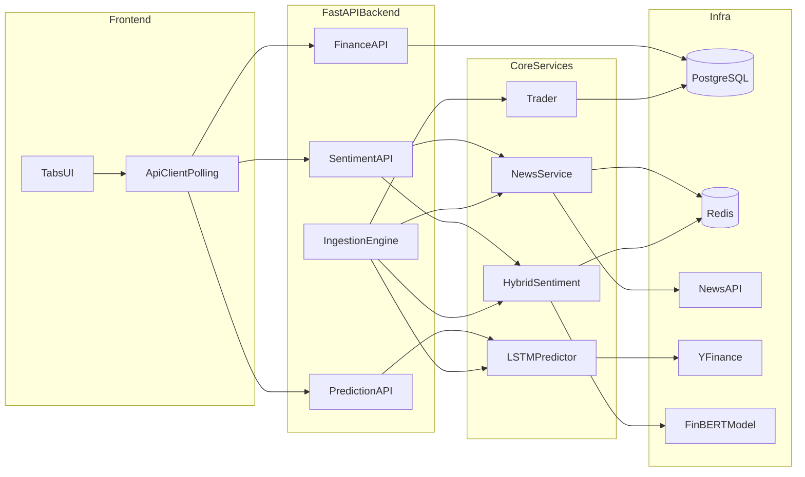

# Architecture

## System Diagram

## Data Flow
1. News fetched from NewsAPI and cached in Redis.
2. Sentiment service computes VADER and FinBERT scores and fuses hybrid score.
3. Predictor trains/infers lightweight LSTM on recent market + sentiment features.
4. Trader executes paper trades if hybrid threshold and predictor signal are positive.
5. Finance APIs provide mark-to-market portfolio and benchmark analytics.

## Research Mapping
- Hybrid weighting (`0.4 VADER + 0.6 FinBERT`) follows hybrid lexicon+transformer research.
- Predictor consumes both technical and sentiment features, consistent with FinBERT-LSTM-style methodologies.

## Notes
- This is paper-trading only.
- Backtest module currently provides lightweight metrics and should be expanded with transaction costs and walk-forward validation.
