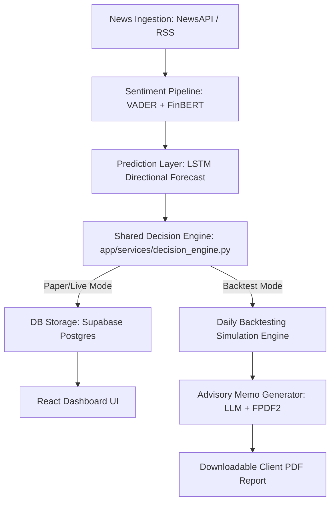

# 📈 Market Sentiment Intelligence Platform (Analyst-Track Portfolio)

[](https://fastapi.tiangolo.com/)
[](https://react.dev/)
[](https://pytorch.org/)
[](https://www.postgresql.org/)

An end-to-end financial intelligence platform that ingests news headlines, scores sentiment using a hybrid FinBERT-VADER ensemble, forecasts short-term ticker direction via LSTM, executes simulated paper trades, and auto-generates compliance-verified PDF advisory client memos.

---

## 📊 Performance scoreboard

### 1. Backtesting Strategy Results (Aug 2022 - Oct 2023)
Evaluated on out-of-sample data (Jan 2023 - Oct 2023) after walk-forward parameter tuning. Strategy execution is event-driven: decisions are based on Day $T$ close data and executed at Day $T+1$ Open, fully mitigating look-ahead bias. Enforces a 30% stock exposure cap, 10% cash floor, 5% stop-loss, and 15% take-profit.

| Strategic Configuration | Return (%) | CAGR (%) | Sharpe Ratio | Sortino Ratio | Max Drawdown (%) | Trades Count | Win Rate (%) | Monte Carlo Rank |
| :--- | :---: | :---: | :---: | :---: | :---: | :---: | :---: | :---: |
| **Aggressive (40% Cap, 5% Cash)** | **27.35%** | **36.96%** | **3.45** | **6.75** | **-2.63%** | 35 | 50.00% | **99.2nd Percentile** |
| **Moderate Balanced (30% Cap, 10% Cash)** | **16.84%** | **22.25%** | **3.37** | **6.26** | **-1.73%** | 22 | 50.00% | **98.8th Percentile** |
| **Conservative (20% Cap, 20% Cash)** | **6.34%** | **8.15%** | **2.92** | **5.45** | **-0.97%** | 10 | 100.00% | **97.6th Percentile** |

> [!NOTE]
> All backtest runs incorporate a **10 basis point (bps)** transaction cost per trade. Monte Carlo rankings represent the strategy's Sharpe percentile against a 1,000-run simulation shuffling historical daily signals, verifying statistical edge over noise.

---

### 2. Sentiment Models Evaluation Benchmark
Model accuracy, F1-scores, latency, and API costs evaluated side-by-side across two datasets:

| Dataset / Model | Accuracy (%) | Macro F1 (%) | Avg Latency (s) | Cost per 1K Headlines ($) |
| :--- | :---: | :---: | :---: | :---: |
| **Financial PhraseBank (Public Benchmark)** | | | | |
| - *VADER* | 54.50% | 42.71% | 0.0001s | $0.00 |
| - *FinBERT* | **65.00%** | **67.77%** | 0.0744s | $0.00 (Local CPU/GPU) |
| - *Gemini 1.5 Flash* | 58.00% | 48.22% | 0.2500s | $0.38 (API) |
| **Local Ingest Dataset (100 Hand-Labeled)** | | | | |
| - *VADER* | 50.00% | 48.99% | 0.0001s | $0.00 |
| - *FinBERT* | **77.00%** | **64.47%** | 0.0449s | $0.00 (Local CPU/GPU) |
| - *Gemini 1.5 Flash* | 42.00% | 43.19% | 0.2500s | $0.38 (API) |

---

## 🛠️ Architecture overview



---

## 🚀 Running the project

### 1. Data Download & Preprocessing
To download the Hugging Face RSS dataset, run local FinBERT batches, download stock prices, and save parquet caches:
```bash
python scripts/download_backtest_data.py
```

### 2. Running Backtests
To run the portfolio backtester and calculate comparison metrics + Monte Carlo percentiles:
```bash
PYTHONPATH=. python -m app.services.backtest_engine
```

### 3. Running the Sentiment Evaluation Harness
To benchmark sentiment models against PhraseBank and our local hand-labeled dataset:
```bash
PYTHONPATH=. python app/services/eval_harness.py
```

### 4. Running Memos Generation Demo
To compile the three strategic PDF memos under `reports/memos/`:
```bash
PYTHONPATH=. python scripts/generate_memos_demo.py
```

### 5. Running the FastAPI Backend & React Frontend
```bash
# Start backend (Uvicorn)
uvicorn app.main:app --reload

# Start frontend
cd frontend
npm run dev
```

---

## 🛡️ Interview Talking Points (Data Analyst JD Alignment)

* **How is look-ahead bias solved?** Decisions are generated on Day $T$ and executed strictly at the Open price of Day $T+1$.
* **What are the backtest limits?** Survivorship bias remains unsolved due to a static 8-ticker mega-cap universe. We volunteer this limit transparently in `docs/backtesting.md` and print a warning in the client PDF memos.
* **Why the hybrid VADER-FinBERT model?** FinBERT has superior context comprehension on financial vocabulary (scoring 77% macro F1 locally), while VADER is free and executes with microsecond latency. We blend them with a 60% FinBERT / 40% VADER weighted score.
